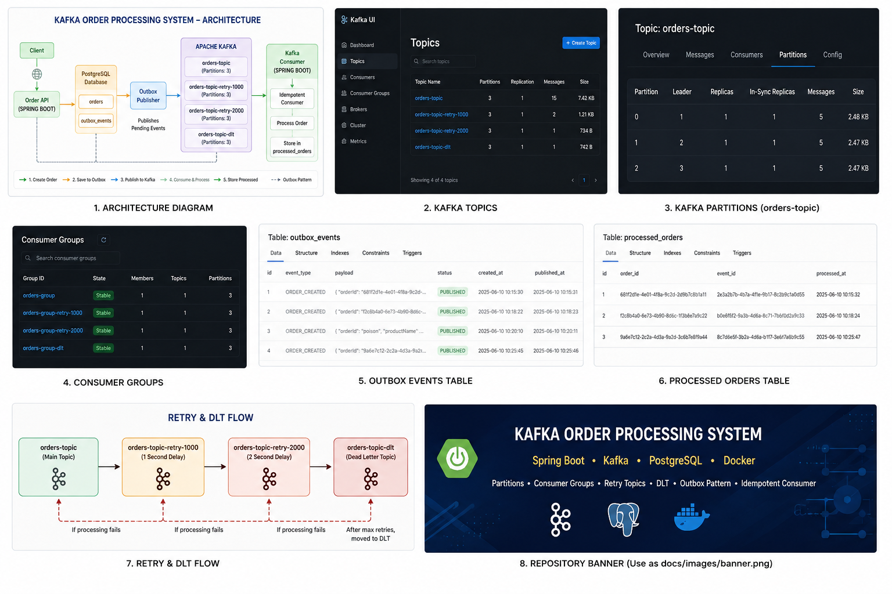
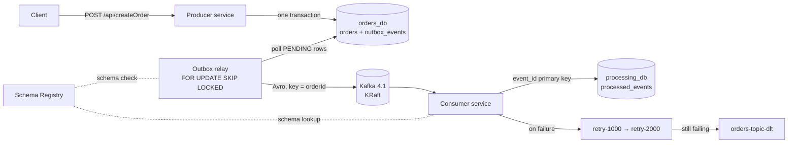

# Kafka Order Processing System



[](https://github.com/gm-mani/kafka-order-processing-system/actions/workflows/ci.yml)

An event-driven order pipeline built with Spring Boot and Apache Kafka. The focus is on reliability: no lost events, no duplicate processing, and safe schema changes. It is not a "hello world" producer and consumer.

- **Producer service** accepts orders over REST. It writes the order and an outbox event in one database transaction. A relay then publishes the event to Kafka as Avro.
- **Consumer service** reads the events, processes each one exactly once (idempotent), retries failures on retry topics, and parks poison messages in a dead letter topic.

---

## Architecture



---

## What this project demonstrates

### 1. Transactional outbox
The order row and its event are saved in **the same Postgres transaction**. Kafka is never called inside the request. If Kafka is down, the order still saves, and the event waits in `outbox_events` until Kafka returns.

### 2. Hardened outbox relay
- Picks up rows with `SELECT ... FOR UPDATE SKIP LOCKED`. Several producer instances can run side by side, and each row is picked up by only one of them.
- Row status is one of `PENDING`, `PUBLISHED` or `FAILED`, with `retry_count` and `last_error` columns.
- **A Kafka outage does not count as a failure.** Rows stay `PENDING` with `retry_count = 0` and go out once the broker is back.
- **A broken row is parked.** An unreadable payload becomes `FAILED` immediately. Other errors become `FAILED` after `max-retries` (default 5), so one bad row cannot block the queue forever.
- The relay processes rows in id order and stops at the first failure, which keeps per-order ordering intact.
- A cleanup job deletes `PUBLISHED` rows older than 7 days.

### 3. Safe Kafka producer settings
`acks=all`, `enable.idempotence=true`, `max.in.flight.requests.per.connection=5` and `lz4` compression. Short timeouts (`max.block.ms=3000`, `delivery.timeout.ms=10000`) let the relay notice an outage quickly instead of hanging.

### 4. Avro event contract and Schema Registry
- The schema lives in its own module (`order-events`). Producer and consumer share the generated `OrderCreatedEvent` class.
- The compatibility mode is pinned to **BACKWARD**. Schema v2 added `currency` with a default of `"INR"`, so old events can still be read.
- `scripts/check-schema-compat.sh` checks a schema change against the registry before you ship it. See [docs/schema-evolution.md](docs/schema-evolution.md).

### 5. Idempotent consumer
Kafka delivers **at least once**, so duplicates can happen. The consumer inserts each `event_id` into `processed_events`, where it is the primary key. A duplicate hits the key constraint, gets logged and is acknowledged without being processed again. Offsets are committed manually, and only after the insert succeeds.

### 6. Retry topics and DLT
A failing message is retried without blocking the partition:

```text
orders-topic → orders-topic-retry-1000 (1 s) → orders-topic-retry-2000 (2 s) → orders-topic-dlt
```

To try it, send an order with `"orderId": "poison"`.

### 7. Database migrations
Both services use **Flyway** migrations, and Hibernate runs with `ddl-auto: validate`. The schema is versioned in git and never generated at runtime.

### 8. Ordering
Every event is keyed by `orderId`. All events for one order land on the same partition and are read in order. The `orders-topic` has 3 partitions.

---

## Tech stack

| Area | Used |
|---|---|
| Language and framework | Java 21, Spring Boot 4, Spring Kafka, Spring Data JPA (Hibernate 7) |
| Messaging | Apache Kafka 4.1 in **KRaft mode, no ZooKeeper** (Confluent Platform 8.1 images) |
| Serialization | Apache Avro 1.12, Confluent Schema Registry |
| Database | PostgreSQL 17, Flyway |
| Observability | Spring Boot Actuator, Micrometer, Prometheus, Grafana, kafka-exporter, Kafka UI |
| Build and CI | Maven multi-module, GitHub Actions |
| Testing | JUnit 5, Mockito |

---

## Project layout

```text
.
├── order-events/        Avro schema (.avsc) → generated Java classes, shared by both services
├── producer/            REST API, orders + outbox tables, outbox relay       (port 8080)
├── consumer/            Kafka listener, idempotency table, retry + DLT       (port 8082)
├── docker/postgres/     init.sql (creates processing_db next to orders_db)
├── monitoring/          prometheus.yml
├── scripts/             check-schema-compat.sh + an example breaking schema
├── docs/                schema-evolution.md, images
├── docker-compose.yaml  local infrastructure
└── pom.xml              parent POM (modules + pinned versions)
```

---

## Running locally

**Prerequisites:** Java 21, Maven, Docker Desktop.

```bash
# 1. Start the infrastructure (Kafka, Schema Registry, Postgres, monitoring)
docker compose up -d
docker compose ps          # wait until kafka shows "healthy"

# 2. Build everything (generates the Avro classes too)
mvn clean install

# 3. Run the two services in separate terminals
mvn -pl producer spring-boot:run
mvn -pl consumer spring-boot:run
```

### Create an order

```bash
curl -X POST http://localhost:8080/api/createOrder \
  -H "Content-Type: application/json" \
  -d '{"orderId":"order-1","productName":"Laptop","price":999.99}'
```

### See what happened

```bash
# Outbox row on the producer side (should be PUBLISHED)
docker exec kafka-postgres psql -U postgres -d orders_db \
  -c "select aggregate_id, status, retry_count from outbox_events order by id desc limit 5;"

# Processed event on the consumer side
docker exec kafka-postgres psql -U postgres -d processing_db \
  -c "select * from processed_events order by processed_at desc limit 5;"
```

### Local URLs

| Service | URL |
|---|---|
| Producer API | http://localhost:8080 |
| Consumer | http://localhost:8082 |
| Kafka UI | http://localhost:8085 |
| Schema Registry | http://localhost:8081 |
| Prometheus | http://localhost:9090 |
| Grafana | http://localhost:3000 |
| pgAdmin | http://localhost:5050 |
| Kafka (from the host) | localhost:9092 |

---

## Configuration

Every connection setting can be overridden with an environment variable. The defaults work with `docker compose`.

| Variable | Default |
|---|---|
| `DB_URL` | `jdbc:postgresql://localhost:5432/orders_db` (producer), `.../processing_db` (consumer) |
| `DB_USER` / `DB_PASSWORD` | `postgres` / `postgres` |
| `KAFKA_BOOTSTRAP_SERVERS` | `localhost:9092` |
| `SCHEMA_REGISTRY_URL` | `http://localhost:8081` |

Outbox relay tuning (producer `application.yaml`):

| Property | Default | Meaning |
|---|---|---|
| `outbox.relay.poll-interval-ms` | `1000` | How often the relay looks for PENDING rows |
| `outbox.relay.batch-size` | `20` | Rows locked per poll |
| `outbox.relay.max-retries` | `5` | Non-outage failures before a row is parked as FAILED |

---

## Testing and CI

```bash
mvn verify
```

GitHub Actions runs `mvn verify` for the producer and the consumer in parallel, each against a real Postgres 17 service container and a Kafka broker.

Unit tests cover the relay's main paths: a successful publish, parking after max retries, a Kafka outage that does not use up retries, and an unreadable payload that is parked without blocking the next row.

---

## Author

**G M Mani**. Backend engineer (Java, Spring Boot).
